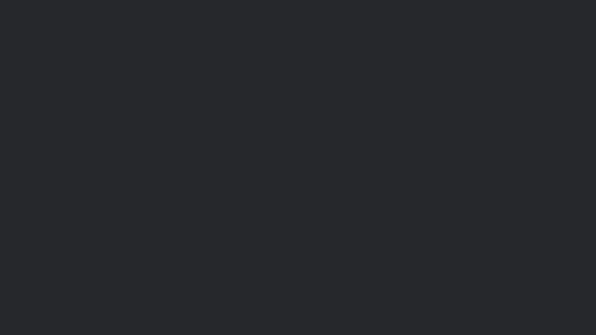

이 글은 사이트가 제대로 도는지 보려고 넣어둔 예시입니다. 지우거나 고쳐 쓰셔도 됩니다. 으앗?

## 제목은 이렇게 답니다

문단은 그냥 줄 띄우고 쓰면 됩니다. **굵게** 쓰거나 *기울여* 쓸 수 있고, [링크](https://github.com/R4mh0)도 됩니다.

사진은 이렇게 넣습니다.

## 목록도 됩니다

- 첫째 줄
- 둘째 줄
- 셋째 줄

> 이렇게 쓰면 인용문이 됩니다.

여기까지가 예시입니다.
